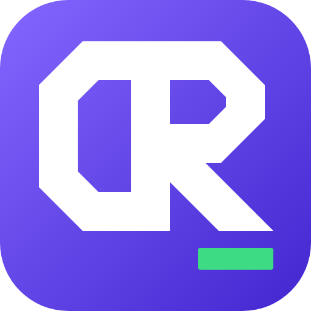

<p align="center">
  
</p>

<h1 align="center">0Rzxn_ Launcher</h1>

<p align="center">
  A fast, modern launcher for <b>Minecraft: Java Edition</b> on Windows, Linux and macOS.<br>
  Vanilla, mod loaders, Modrinth mods and modpacks, all in one dark, clean interface.
</p>

<p align="center">
  
  
  
</p>

> **NOT AN OFFICIAL MINECRAFT PRODUCT. NOT APPROVED BY OR ASSOCIATED WITH MOJANG OR MICROSOFT.**

0Rzxn_ Launcher is a free, non-commercial hobby project. It downloads the game only from Mojang's official servers and signs players in with their **own** Microsoft account, so it can only launch copies of Minecraft that players own.

*Version française : [README.fr.md](README.fr.md)*

---

## Download

Get the latest version from the [releases page](https://github.com/xRzxnx/0Rzxn-Launcher/releases/latest).

| System | File | |
|---|---|---|
| Windows 10 or 11 (x64) | `0Rzxn_-Launcher-Setup-<version>.exe` | Installs for the current user, updates itself. |
| Linux (x64) | `0Rzxn_-Launcher-<version>.AppImage` | Experimental, updates itself. |
| macOS, Apple Silicon | `0Rzxn_-Launcher-<version>-arm64.dmg` | Experimental, not signed by Apple. |
| macOS, Intel | `0Rzxn_-Launcher-<version>-x64.dmg` | Experimental, not signed by Apple. |

**Linux:** make the file executable (`chmod +x 0Rzxn_-Launcher-*.AppImage`) and open it. AppImages need FUSE 2: install `libfuse2` (`libfuse2t64` on Ubuntu 24.04 and later). Minecraft versions older than 1.13 need `xrandr` (package `x11-xserver-utils`, already there on most desktops). Your Microsoft session is kept between launches only if a keyring is installed (GNOME Keyring or KWallet); without one, you sign in again each time.

**macOS:** open the dmg and drag the launcher into Applications. The app isn't signed by Apple, so macOS blocks the first launch: open **System Settings › Privacy & Security** and click **Open Anyway**. Updates aren't automatic on macOS: the launcher tells you when a new version is out and opens its page. On Apple Silicon Macs, Minecraft versions older than 1.19 run through Rosetta.

## Features

**Game**
- Every vanilla release and snapshot from Mojang's official version manifest, including the new `26.x` numbering.
- Verified downloads (SHA-1 and size checks, retries, parallel downloads), shared between instances.
- Automatic Java: Mojang's official runtimes (Java 8, 17, 21, 25), or any Java installed on the PC.
- Separate instances with their own settings and playtime statistics, sorted by loader then newest version, with search.

**Mods**
- Mod loaders installed automatically: **Fabric**, **Quilt**, **Forge** and **NeoForge**.
- **Modrinth** browser for mods, resource packs and shaders, filtered for the instance, with dependencies and updates.
- Modpacks: install from Modrinth, import or export `.mrpack` files, update while keeping settings and worlds.
- Import instances from other launchers that keep each instance in its own folder with an `instance.cfg` file (the source is only read, never modified).

**Content**
- Crash reports explained in plain language, with one-click fixes for common problems (wrong Java, missing or incompatible mods, low memory).

**Performance**
- Tuned Java arguments chosen automatically for the PC (G1 or generational ZGC).
- Recommended memory based on the loader and number of mods.
- Optional performance pack (Sodium, Lithium, FerriteCore and others) checked against Modrinth for the exact version and loader.
- Light mode: the launcher uses almost no CPU while the game is running.

**Comfort**
- Available in **English**, **French** and **Spanish**: follows the system language, and changes instantly in Settings › Launcher.
- Accent color themes, system tray menu, keyboard shortcuts (AZERTY-friendly).
- Automatic updates: new versions download in the background, never during a game, and install on restart (on macOS, the launcher opens the download page). An opt-in beta channel is in Settings › Launcher.
- Java and disk storage management.
- Skin preview in 3D, saved skins, capes.

## Microsoft sign-in and privacy

Signing in uses Microsoft's official flow, exactly like other third-party launchers:

```
Microsoft login page (consumers tenant, XboxLive.signin + offline_access, authorization code with PKCE)
  → Xbox Live → XSTS → Minecraft services (login_with_xbox)
  → game ownership check → player profile
```

- **The launcher never sees your password.** You type it on Microsoft's own login page.
- Tokens are stored **encrypted by the system** (Electron `safeStorage`: Windows DPAPI, the macOS Keychain, GNOME Keyring or KWallet on Linux) on your PC only. On Linux without a keyring, they stay in memory and are never written to disk.
- Tokens are only sent to Microsoft, Xbox Live and Minecraft services, and to the local game process. They are masked in logs and crash reports.
- No telemetry, no analytics, no ads, nothing sold.
- The Azure application is registered for **personal Microsoft accounts only**.

**Offline profiles** (singleplayer and LAN) are unlocked only after a Microsoft account that owns Minecraft: Java Edition has been added to the launcher. The launcher cannot be used to play without owning the game.

## Getting started

Requirements: Windows 10 or 11 (x64), Linux or macOS, and [Node.js](https://nodejs.org/) 20 or later.

```bash
npm install
npm start
```

### Build the Windows installer

```bash
npm run dist
```

The installer is written to `dist/`. It installs for the current Windows user, without administrator rights. Local builds are not signed, so Windows SmartScreen may ask for confirmation (**More info → Run anyway**). Released installers are built by GitHub Actions; see the [code signing policy](#code-signing-policy).

### Publish a version

Change the version in `package.json`, commit, push `main`, then run:

```bash
npm run publier
```

The script checks the repository, then starts the [Release workflow](.github/workflows/release.yml): GitHub Actions builds the installer from `main`, signs it (once SignPath has accepted the project), checks it on VirusTotal and publishes the release that installed launchers read. It needs the GitHub CLI (`gh`) signed in. `npm run publier -- --essai` only builds, on the current branch.

A version like `1.2.3-beta.1` is published as a GitHub pre-release: only launchers with **Settings › Launcher › Updates › Get beta versions** turned on receive it.

## Where data is stored

| Windows | Linux | macOS | Content |
|---|---|---|---|
| `%APPDATA%\.0rzxn\` | `~/.local/share/0rzxn/` | `~/Library/Application Support/.0rzxn/` | Versions, libraries, assets, Java runtimes and instances |
| `%APPDATA%\0Rzxn_ Launcher\` | `~/.config/0Rzxn_ Launcher/` | `~/Library/Application Support/0Rzxn_ Launcher/` | Accounts (tokens encrypted) and launcher settings |

Uninstalling keeps your worlds and settings.

## Project structure

```
src/
├─ main/            Electron main process
│  ├─ main.js         window and security settings
│  ├─ preload.js      the only API exposed to the interface
│  ├─ ipc.js          interface ↔ core channels
│  ├─ i18n/           messages of the main process (fr, en, es)
│  └─ core/           launcher core in plain Node.js (downloads, versions,
│                     loaders, Modrinth, Microsoft sign-in, launch pipeline…)
└─ renderer/        interface (HTML, CSS, vanilla JavaScript, no framework)
                    its texts are in js/locales/ (fr, en, es); npm run check:i18n checks them
```

## Code signing policy

Free code signing provided by [SignPath.io](https://about.signpath.io), certificate by [SignPath Foundation](https://signpath.org). The application is pending: until it is accepted, releases are not signed. Team roles, how releases are built and the privacy policy: [CODE_SIGNING_POLICY.md](CODE_SIGNING_POLICY.md).

## Credits

- Game files, Java runtimes and version data come from Mojang's official servers.
- Mods, modpacks and shaders come from the [Modrinth](https://modrinth.com/) API.
- Fonts: [Geist](https://vercel.com/font) and [Pixelify Sans](https://fonts.google.com/specimen/Pixelify+Sans), under the SIL Open Font License (see `src/renderer/assets/fonts`).

## License

[MIT](LICENSE) © 2026 0Rzxn_

Minecraft is a trademark of Mojang Synergies AB. This project is not affiliated with Mojang or Microsoft.
